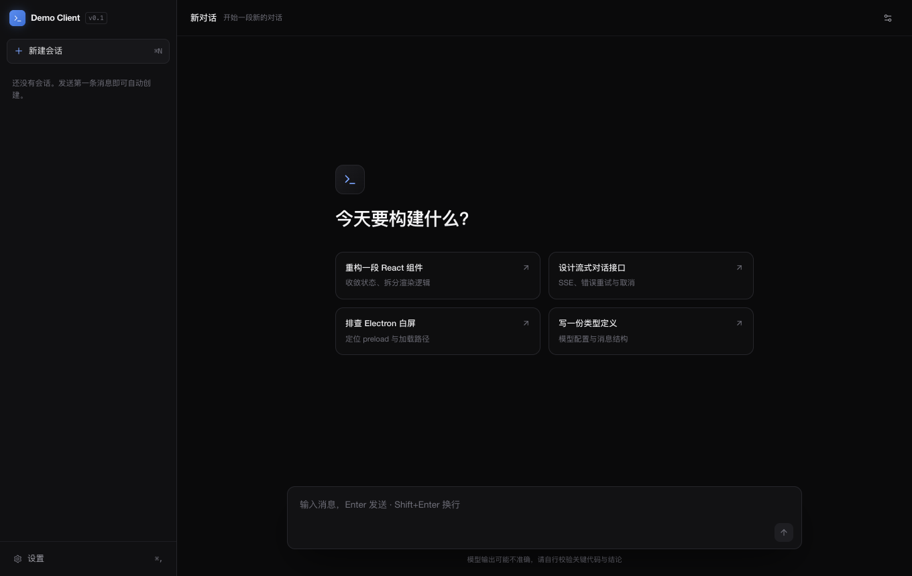
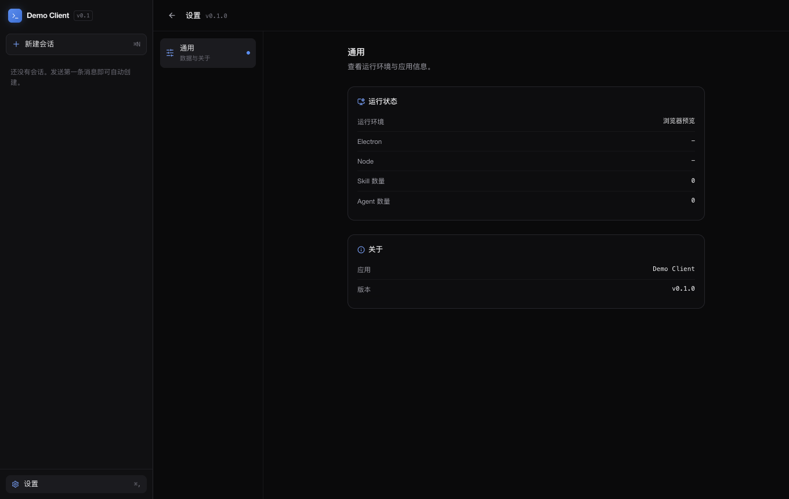
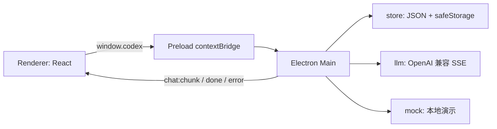

# Demo Client

一个参考 Codex 桌面端交互方式的 AI 对话客户端：Electron + React + TypeScript，暗色开发者工作台风格，支持流式对话、会话管理、模型切换与自定义模型。

未配置 API Key 时使用内置的本地模拟流式回复，开箱即可体验完整交互；填入任意 OpenAI 兼容端点后立即切换为真实模型输出。





## 功能

- **主对话区**：流式逐字输出、Markdown / GFM 渲染、代码块语言标签与复制、自动滚动跟随、停止生成、错误提示与 Mock 兜底提示。
- **会话管理**：新建、切换、重命名、删除，按时间分组展示，本地持久化并在重启后恢复。
- **设置 - 模型**：内置 GPT-5 / GPT-5-Codex / GPT-5 mini / o4-mini 与 DeepSeek V4.1-Flash / V3 / R1；支持添加自定义模型（显示名、模型 ID、供应商、描述）并删除。
- **设置 - API**：内置 **OpenAI** 与 **DeepSeek** 两条供应商通道，各自独立保存 Base URL、API Key（密文显示）、温度；支持连接测试与端点预设。
- **设置 - 通用**：运行状态、会话数据统计与清空、关于信息。
- **模型选择全局生效**：顶部徽标、输入区模型菜单、请求参数读取同一份设置状态，切换后立即作用于新消息。
- **模型锁定开关**：通过 `config/app.config.json` 的 `allowModelSwitch` 控制是否允许切换模型；关闭时固定使用 `deepseek-V4.1-Flash` 并隐藏相关入口。
- **界面显示开关**：`ui.showSidebarStatus` / `ui.showChatModel` / `ui.showTopBarStatus` 分别控制侧栏连接状态、对话区模型信息、顶栏状态与模型名称，默认全部隐藏。
- **插件导入**：设置 → 插件，从本地文件夹导入 Agent 与 Skill，实时生效并参与对话（详见下文）。
- **快捷键**：`⌘/Ctrl + N` 新建会话，`⌘/Ctrl + ,` 打开设置，`Esc` 返回对话。

## 技术栈

| 层 | 选型 |
| --- | --- |
| 桌面壳 | Electron 33（`contextIsolation: true`，`nodeIntegration: false`） |
| 渲染层 | React 18 + TypeScript 5 + Vite 5 |
| 样式 | Tailwind CSS 3.4 + 自定义暗色 tokens |
| Markdown | react-markdown + remark-gfm |
| 状态 | React Context + hooks（无额外状态库） |
| 网络 | 主进程 Node `fetch` 请求 SSE 流，经 IPC 推送到渲染层 |
| 持久化 | `app.getPath('userData')` 下 JSON 文件；API Key 使用 `safeStorage` 加密 |

## 快速开始

```bash
npm install
npm run dev        # 同时启动 Vite 与 Electron 窗口
```

其他脚本：

```bash
npm run dev:web    # 仅启动浏览器预览（内置 mock 桥接，便于调 UI）
npm run build      # 类型检查 + 前端生产构建
npm run start      # 用已构建的 dist 启动 Electron
npm run dist       # 使用 electron-builder 打包 dmg（可选）
npx electron-builder --mac dir   # 仅生成可双击的 .app（输出到 release/mac-arm64/）
npm run encrypt -- 源文件夹       # 将插件文件夹加密打包为 .assterplugin
```

要求 Node 18+（开发环境使用 Node 24 验证）。

## 配置真实模型

应用内置两条 OpenAI 兼容通道，模型自带 `providerId`，对话时自动使用对应通道的端点与密钥。

| 供应商 | 默认 Base URL | 内置模型 |
| --- | --- | --- |
| OpenAI | `https://api.openai.com/v1` | GPT-5-Codex / GPT-5 / GPT-5 mini / o4-mini |
| DeepSeek | `https://api.deepseek.com` | deepseek-V4.1-Flash (`deepseek-flash`) / DeepSeek V3 (`deepseek-chat`) / DeepSeek R1 (`deepseek-reasoner`) |

配置步骤：

1. 打开 **设置 → API 连接**，在顶部选择 OpenAI 或 DeepSeek 通道。
2. 确认 Base URL（DeepSeek 默认已填好 `https://api.deepseek.com`）。
3. 填写该通道的 API Key —— 某个通道未配置时，使用该通道的模型会保持本地演示模式。
4. 点击「保存配置」；可点击「测试连接」用该通道下的首个模型验证连通性。
5. 在 **设置 → 模型** 中选择模型，或在「添加自定义模型」时选择所属供应商；模型 ID 会作为请求中的 `model` 参数透传。

请求路径为 `${BaseURL}/chat/completions`，使用 `stream: true` 的 SSE 响应。若真实请求失败，应用会自动回落到本地演示回复，并在消息中标注原因。

> 旧版本的单一 `api` 配置会在启动时自动迁移为 OpenAI 通道，密钥不会丢失。

`deepseek-flash` 对应 DeepSeek 官方的 DeepSeek-V4.1-Flash-1017 模型（官方说明：模型名请使用 `deepseek-flash`）。

## 应用配置

运行时配置文件 `config/app.config.json`：

```json
{
  "allowModelSwitch": false,
  "ui": {
    "showSidebarStatus": false,
    "showChatModel": false,
    "showTopBarStatus": false,
    "showSettingsNavHint": false,
    "showRuntimeDetails": false,
    "showLocalData": false,
    "showAboutDetails": false
  }
}
```

### 模型切换（allowModelSwitch）

| 取值 | 行为 |
| --- | --- |
| `true` | 允许在输入区模型菜单、顶部模型入口、设置「模型」页自由切换与添加模型；「API 连接」页可配置各通道密钥 |
| `false` | 锁定为 `deepseek-V4.1-Flash`：隐藏输入区模型菜单（显示只读模型标识）、顶部模型入口，设置中仅保留「通用」，「模型」与「API 连接」两个分组隐藏 |

### 界面显示（ui）

| 配置项 | 默认 | 作用 |
| --- | --- | --- |
| `ui.showSidebarStatus` | `false` | 左下角连接状态（「DeepSeek 已连接」/「本地演示模式」），隐藏后仅保留设置按钮 |
| `ui.showChatModel` | `false` | 输入区模型选择/只读模型标识，并联动空态欢迎页中的模型与连接说明 |
| `ui.showTopBarStatus` | `false` | 右上角连接状态与当前模型名称；设置齿轮始终保留 |
| `ui.showSettingsNavHint` | `false` | 设置页左侧「模型与 API 配置仅保存在本机…」说明 |
| `ui.showRuntimeDetails` | `false` | 「运行状态」中的连接模式、当前模型、模型切换、配置文件、模型数量、供应商通道等技术明细 |
| `ui.showLocalData` | `false` | 「本地数据」卡片及其清空会话操作 |
| `ui.showAboutDetails` | `false` | 「关于」中的技术栈、界面参考、说明文本与返回对话按钮 |

- 所有开关**仅 `true` 时显示**，缺省、非布尔或配置文件缺失时一律隐藏。
- 「运行状态」默认仅展示运行环境（Electron / Node 版本）以及 Skill 数量、Agent 数量（当前数据源未接入，固定为 0）。
- 「关于」默认仅展示应用名称与版本。
- 仓库内当前 `allowModelSwitch` 为 `false`（锁定模式）。需要开放模型切换时改为 `true` 并重启应用。
- 开发环境与打包应用各自读取自己的配置文件。

- 锁定态复用 DeepSeek 通道已保存的 Base URL / API Key；未配置 Key 时仍使用本地演示回复。
- 锁定不会改写已保存的模型选择，改回 `true` 后恢复用户原先的选择。
- 修改配置后**重启应用**生效；`allowModelSwitch` 缺失或非法时按 `true` 处理。
- 开发环境路径：`<项目>/config/app.config.json`；打包后路径：`Demo Client.app/Contents/Resources/config/app.config.json`（可直接编辑该文件，无需重新构建）。
- 配置文件中不包含任何密钥。
- 应用已更名为 **Demo Client**（内部包名 `demo-client`），用户数据目录随之变为 `~/Library/Application Support/Demo Client`，旧会话与密钥不会迁移。

## 插件（Agent 与 Skill）导入

在 **设置 → 插件** 点击「选择资源…」，选择一个 `.assterplugin` 加密资源文件。

**① 准备源文件夹**

```
源文件夹/
├── agents/                 # 可选，每个 .json 文件一个 Agent
│   └── 代码评审.json
└── skills/                 # 可选，每个 .json 文件一个 Skill
    └── 单元测试生成.json
```

**② 加密打包**

```bash
npm run encrypt -- 源文件夹            # 生成 源文件夹名.assterplugin
npm run encrypt -- 源文件夹 -o 自定义名.assterplugin
```

加密采用 AES-256-GCM（共享实现在 `shared/asster-crypto.mjs`，CLI 与应用使用同一解密器）。

**③ 导入**

选择 `.assterplugin` 文件后，应用会解密到隐藏目录 `userData/.asster/import-xxx/`，随后扫描其中的 `agents/`、`skills/` 并校验 `.json` 文件。

**文件格式与校验规则**

| 字段 | Agent | Skill | 规则 |
| --- | --- | --- | --- |
| `name` | 必填 | 必填 | 1–50 字符，同名（不区分大小写）跳过 |
| `description` | 选填 | 选填 | ≤200 字符 |
| `systemPrompt` / `instructions` | 必填 | 必填 | Agent ≤8000、Skill ≤12000 字符；Skill 支持 `content` 别名 |
| `tags` | 选填 | 选填 | 字符串数组，≤5 个 |
| `enabled` | — | 选填 | Skill 是否默认启用，默认 `true` |

- 仅扫描 `.json` 文件；子目录与其他扩展名会被忽略并计入反馈。
- 校验失败（非法 JSON、缺少必填字段、超长、同名）会**跳过该文件**并在导入结果中逐条给出「文件 + 原因」。
- 导入结果持久化到用户数据目录的 `plugins.json`。

**反馈方式**：导入完成后，插件页顶部显示结果卡片——成功导入的 Agent/Skill 清单、失败文件及原因、被忽略的文件数；解密失败（文件损坏、非加密包、非法路径）会给出明确的解密错误；取消选择则不做任何改动。

**加载与调用行为**：

- Agent：在「Agent」列表中选中后，其 `systemPrompt` 替代内置默认提示词，作用于之后发送的每条消息；选中「不使用 Agent」即恢复默认。
- Skill：启用的技能指令会以「已启用技能」段落追加到系统提示词，与当前 Agent 叠加；停用后立即不再参与。
- 全部为**实时生效**：导入、启停、切换均即时作用于下一次发送，无需重启；系统提示词总量上限 24000 字符，超出自动截断。
- 通用页的「Agent 数量 / Skill 数量」与插件页列表数量一致，均来自已导入插件。

### 独立加密工具（无需 Node 环境）

`npm run build:encrypt` 会构建两个单文件可执行程序（Node SEA），程序名为 **demo资源加密**：

| 产物 | 平台 | 位置 |
| --- | --- | --- |
| `demo资源加密-macos-arm64` | macOS（Apple Silicon） | `release/tools/` |
| `demo资源加密-windows-x64.exe` | Windows x64 | `release/tools/` |

用法与 `npm run encrypt` 一致：`demo资源加密-macos-arm64 源文件夹 [-o 输出.assterplugin]`

**免控制台使用**：直接双击运行（不带参数）会弹出系统文件夹选择框与保存对话框，选好后自动加密，并通过系统弹窗反馈结果；macOS 使用 osascript、Windows 使用 PowerShell，均为系统内置组件，无需额外依赖。

**依赖与构建约束**

- 构建机需 Node 20+；`esbuild`、`postject` 已在 devDependencies 中
- Windows 目标首次构建需联网下载官方 Node 运行时（缓存于 `build/cache/`），产物与 blob 自动匹配本地 Node 大版本
- macOS 产物为构建机架构（当前 arm64）；跨架构需在对应平台构建
- Windows exe 未签名，SmartScreen 会提示；部分杀毒软件可能误报 SEA 程序
- Windows exe 在 macOS 上无法运行验证，首次使用请在 Windows 实机确认

**加密方式与密钥管理**

- 算法：AES-256-GCM + scrypt 派生密钥，随机 salt/iv，输出带 `ASSTERPLUGIN1:` 文件头的单文件
- 密钥：默认使用内置口令（演示级混淆，非强保密）；加密工具与应用均支持环境变量 `ASSTERPLUGIN_KEY` 覆盖，两侧需一致

## 目录结构

```
.
├── config/
│   └── app.config.json        # 运行时配置：allowModelSwitch + ui 显隐开关
├── electron/
│   ├── main.mjs               # 主进程：窗口、安全策略、IPC 注册
│   ├── preload.cjs            # contextBridge 暴露最小 API（window.codex）
│   ├── ipc/
│   │   ├── chat.ipc.mjs       # 流式请求、取消、连接测试
│   │   └── settings.ipc.mjs   # 设置/会话读写与变更广播
│   └── services/
│       ├── appConfig.mjs      # 运行时配置读取与校验（开发/打包双路径）
│       ├── store.mjs          # JSON 持久化 + safeStorage 加密
│       ├── llm.mjs            # OpenAI 兼容流式请求
│       ├── sse.mjs            # SSE 解析
│       └── mock.mjs           # 本地模拟流式回复
├── src/
│   ├── components/
│   │   ├── layout/            # AppShell、Sidebar、TopBar
│   │   ├── chat/              # 消息列表、Markdown、输入区、模型菜单
│   │   ├── settings/          # 设置页与各分组面板
│   │   └── ui/                # Button、Form、Modal、Toast
│   ├── hooks/                 # useChat、useSettings、useAutoScroll
│   ├── state/                 # ChatProvider、SettingsProvider
│   ├── lib/                   # 常量、工具、IPC 封装、浏览器降级桥接
│   ├── types/                 # 共享类型与 window.codex 声明
│   └── styles/                # Tailwind 入口与暗色 tokens
├── public/favicon.svg
├── scripts/                   # 独立加密工具构建脚本（Node SEA）
├── shared/                    # 加解密共享实现（应用与 CLI 共用）
├── electron-builder.yml
└── vite.config.ts
```

## 架构说明



- 运行时配置 `config/app.config.json` 由主进程启动时读取一次（开发/打包双路径），经 `codex:app:config` 暴露给渲染层；锁定判断在 `SettingsProvider` 统一派生。
- 渲染层不直接持有网络能力，所有模型请求与密钥读写收敛在主进程。
- 流式增量以 `requestId` 匹配，渲染层用 `requestAnimationFrame` 合批后写入状态，避免逐 token 重渲染。
- 模型与 API 配置保存在 `settings.json`，会话保存在 `conversations.json`；浏览器预览模式降级到 `localStorage`。
- 新增内置模型只需修改 `src/lib/constants.ts`；接入其他供应商时在 `electron/services/llm.mjs` 增加适配分支即可。

## 数据与隐私

- API Key 优先通过 Electron `safeStorage` 加密后落盘；系统不支持时退化为明文，并在设置页提示运行环境。
- 密钥不会写入日志，也不会回传到渲染层的日志中。
- 所有数据仅保存在本机用户数据目录，不上传任何第三方服务（模型请求直接发往你配置的端点）。
